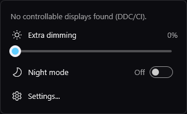
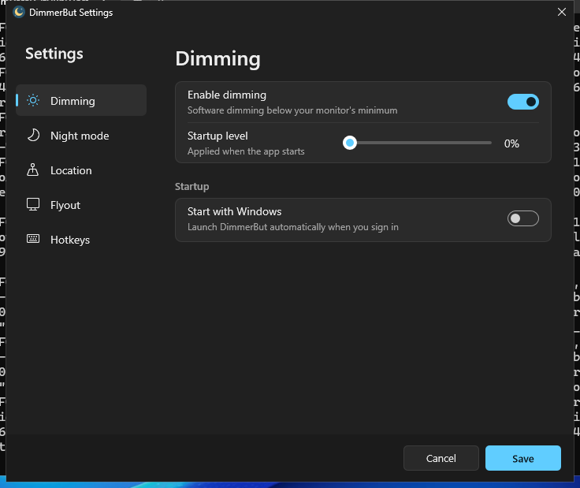

# DimmerBut

A Windows tray app that dims your screen below its minimum brightness, adjusts monitor brightness, and applies an f.lux-style night mode, all from a flyout next to the clock.

DimmerBut is written in Rust (`dimmerbut-rs/`) with native Win32 and Direct2D drawing. It ships as a single exe that needs no installer or extra runtime.





## Features

- **Software dimming.** Dims the whole screen, including video overlays, the taskbar and the Start menu, through the Windows Magnification API. Levels go from 0 to 90 in steps of 10.
- **Hardware brightness.** Shows a slider for each display. External monitors are controlled over DDC/CI, and laptop panels through WMI.
- **Monitor power.** Can turn an external monitor off from the flyout. You can hide this control in settings.
- **Night mode.** Shifts colour temperature from daytime, to sunset, to bedtime, then back in the morning. Sunrise and sunset are calculated offline from your location. You can set your location by city name, which uses the [Open-Meteo geocoding API](https://open-meteo.com/en/docs/geocoding-api).
- **Global hotkeys.** Optional keys to raise or lower the dim level.
- **Start with Windows.** Adds a per-user `Run` entry, so no admin rights are needed.

## Requirements

- Windows 10 or 11
- To build from source: a stable Rust toolchain (edition 2024, Rust 1.85 or newer) with the MSVC target

## Install

Download `dimmerbut.exe` from the [Releases page](../../releases) and run it. The icon appears in the tray; click it to open the flyout. Turn on **Start with Windows** in settings if you want it to launch at sign-in.

## Building

```powershell
cd dimmerbut-rs
cargo build --release
```

The binary is written to `dimmerbut-rs/target/release/dimmerbut.exe`. The build statically links the C runtime, so the exe runs without extra installs.

## Releases

The [Release workflow](.github/workflows/release.yml) builds `dimmerbut.exe` and publishes a release. Run it from the Actions tab with **Run workflow**; there is nothing to fill in. The version is the latest `v*` tag with the patch number bumped by one, or the `Cargo.toml` version for the very first release. The first release uses this README as its notes; later ones use GitHub's generated notes.

## Command-line flags

These are for testing:

| Flag | Effect |
| --- | --- |
| `--flyout` | Opens the tray flyout and keeps it pinned open. |
| `--settings` | Opens the settings window straight away. |

## Files

| Path | Purpose |
| --- | --- |
| `%APPDATA%\DimmerBut\settings.json` | Settings. PascalCase keys. |
| `%APPDATA%\DimmerBut\error.log` | Crash and panic log, capped at 512 KB. |

## Screenshots

The screenshots are generated by the [Screenshots workflow](.github/workflows/screenshots.yml). It runs on a Windows runner, starts the Rust build with the test flags above, captures the windows, and commits the PNGs to `docs/screenshots/`. Run it from the Actions tab with **Run workflow**.

## Repository layout

```
dimmerbut-rs/        Rust app (Win32 + Direct2D)
docs/screenshots/    Screenshots used in this README
.github/workflows/   CI: screenshots and release builds
CLAUDE.md            Notes for Claude Code, including the graphify knowledge graph
graphify-out/        Generated code knowledge graph (see below)
```

## Knowledge graph

`graphify-out/` holds a [graphify](https://github.com/safishamsi/graphify) knowledge graph of the code: `GRAPH_REPORT.md` is a readable summary, `graph.html` an interactive view, and `graph.json` the raw data. After changing code, refresh it with:

```powershell
graphify update .
```
